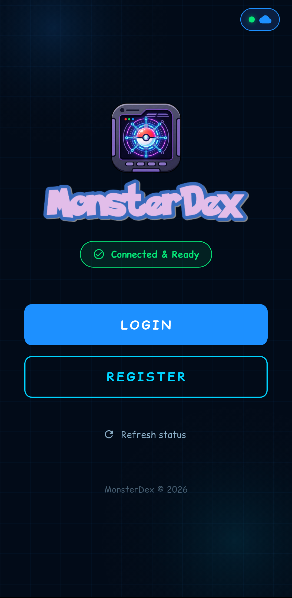
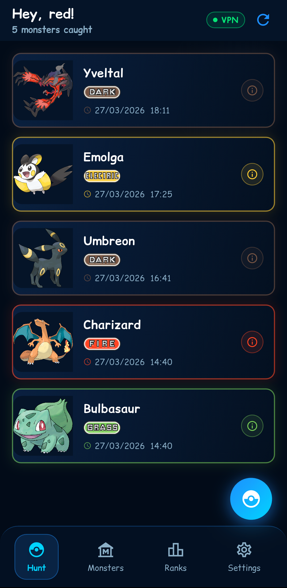
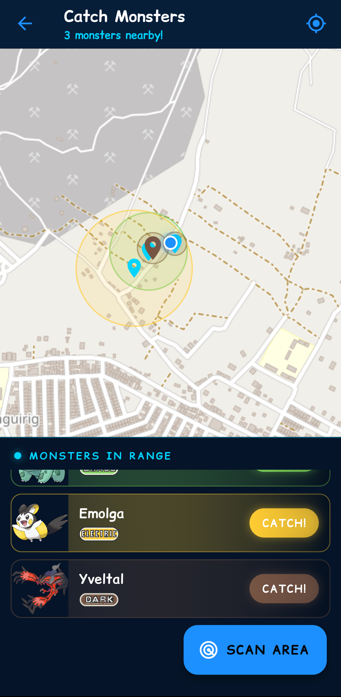
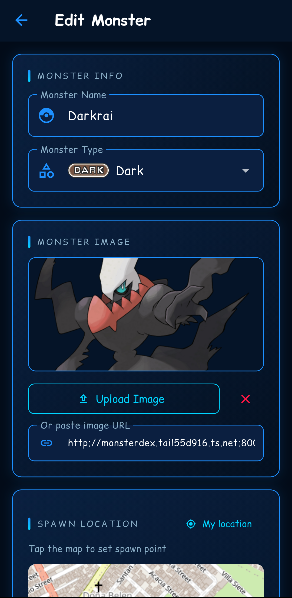
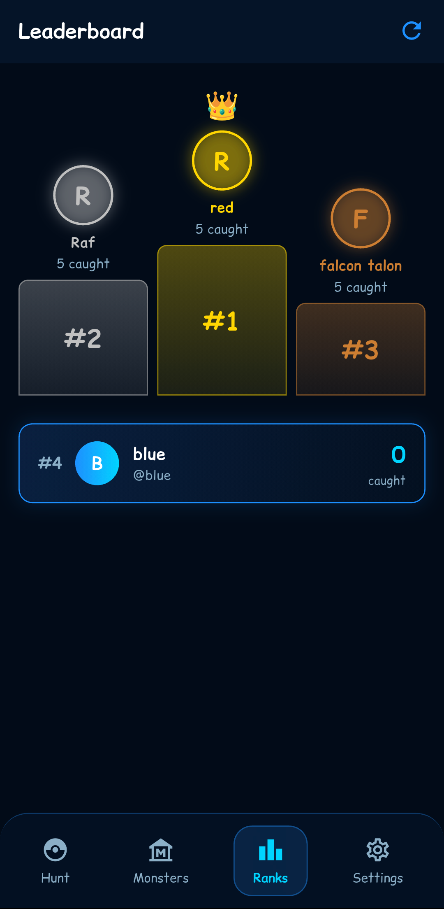
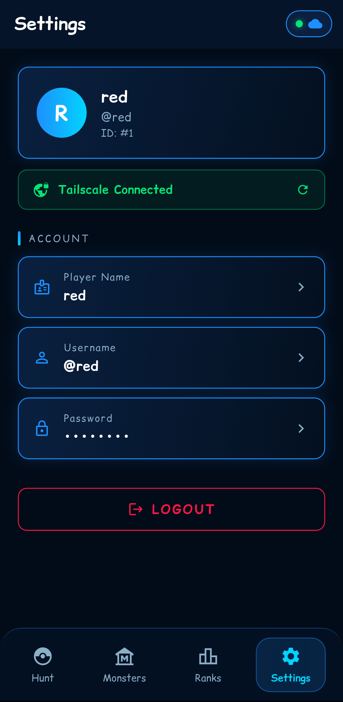

<div align="center">

# 🎮 MonsterDex

**A real-world, GPS-based monster catching game built with Flutter and powered by AWS.**


</div>

<!-- Screenshots: add the six PNGs listed below to assets/images/readme/ -->
<table align="center">
  <tr>
    <td align="center"><br/><sub>Welcome</sub></td>
    <td align="center"><br/><sub>Dashboard</sub></td>
    <td align="center"><br/><sub>Catch</sub></td>
  </tr>
  <tr>
    <td align="center"><br/><sub>Monsters</sub></td>
    <td align="center"><br/><sub>Leaderboard</sub></td>
    <td align="center"><br/><sub>Settings</sub></td>
  </tr>
</table>

> ⚠️ **Project status:** the AWS infrastructure behind MonsterDex (EC2, RDS and Lambda) has been **terminated**, so the app and the APKs on the Releases page **no longer work**. The code and docs are kept as a reference for how it was built, and you can deploy your own backend to run it again.

## Overview

MonsterDex is a location-based monster catching game similar to Pokémon GO. Players connect through a Tailscale VPN, scan their surroundings with GPS, and catch monsters that spawn at registered real-world coordinates.

The backend is a Node.js API on an EC2 web server in Paris, talking to a managed RDS MySQL database in N. Virginia over VPC Peering. A small Lambda function lets the app start and stop the server from the phone.

> 🎓 Built as a course requirement for **Cloud Computing**. See the [academic disclaimer](#credits).

## Features

- 🎮 **Catch monsters:** GPS proximity scan (Haversine), catch sound and 5-second flashlight strobe, per-monster catch details
- 🦎 **Manage monsters:** full CRUD, spawn locations picked on an OpenStreetMap map with a live radius preview, image upload, 18 monster types
- 🏆 **Leaderboard:** top 10 players with a gold/silver/bronze podium
- 🔐 **Accounts:** registration, login, persistent session with auto-login, profile editing
- 🌐 **VPN and server guard:** every action checks server status first, then VPN reachability, and guides the player through whatever is missing
- ☁️ **EC2 control from the app:** start, stop and check the web server through AWS Lambda, with no AWS credentials stored in the app

## How It Works

```
Mobile App (Flutter)
       │
       │ Tailscale VPN (MagicDNS)
       ▼
┌─────────────────────────┐
│  EC2 Web Server         │  eu-west-3 (Paris)
│  Node.js API :8000      │
│  + Tailscale installed  │
└────────────┬────────────┘
             │ VPC Peering
             ▼
┌─────────────────────────┐
│  Amazon RDS MySQL       │  us-east-1 (N. Virginia)
│  haumonstersDB          │
└─────────────────────────┘

┌─────────────────────────┐
│  AWS Lambda             │  us-east-1
│  EC2 Toggle / Status    │
└─────────────────────────┘
```

## Tech Stack

| Layer | Technology |
|-------|------------|
| Mobile app | Flutter / Dart, `flutter_map` (OpenStreetMap), `geolocator`, `audioplayers`, `torch_light` |
| API | Node.js 20, Express, `mysql2`, `multer`, PM2 |
| Database | Amazon RDS, MySQL 8.0 |
| Networking | Tailscale (MagicDNS), AWS VPC Peering |
| Cloud | EC2 (Amazon Linux 2023), Lambda (Python 3.12) |

The full list of app packages is in [`pubspec.yaml`](pubspec.yaml).

## Release APKs (No Longer Functional)

> ⚠️ **The APKs on the [Releases page](https://github.com/Lintahlo-001/MonsterDex/releases) no longer work.** They were built against the project's original AWS servers, which have been terminated, so the app cannot log in or reach a server. They are kept for reference only.
>
> To run MonsterDex today, deploy your own backend (see [Documentation](#documentation)) and [build the app from source](#build-from-source) with your own `env.json`.

<details>
<summary>Original install steps (for reference)</summary>

**You need:** an Android phone running Android 6.0 or newer, the [Tailscale](https://tailscale.com/download) app, and an invite to the project's tailnet (ask the network admin, see [docs/tailscale.md](docs/tailscale.md#joining-the-network)). The game server must also be running, but you can start it from inside the app.

1. **Download the APK.** Open the [latest release](https://github.com/Lintahlo-001/MonsterDex/releases/latest) on your phone, scroll to **Assets**, and tap the `.apk` file.
2. **Allow installs from this source.** Open the downloaded file (from the browser's download notification or the **Files** app). Android will ask for permission to install apps from that source, so tap **Settings** and turn on **Allow from this source**. On Android 7 and older, enable **Settings → Security → Unknown sources** instead.
3. **Install.** Tap **Install**. If Google Play Protect warns about an unrecognized app, tap **More details → Install anyway**. The APK is not distributed through the Play Store, so this warning is expected.
4. **Set up Tailscale.** Install Tailscale from the Play Store, accept the invite to the tailnet, and turn the VPN **on**.
5. **Open MonsterDex and allow permissions.** Grant **location** access (needed to scan for monsters) and, when asked, **photos/media** access (only needed to upload monster images).
6. **Check the server status** on the welcome screen. If the server is stopped, tap the EC2 button to start it and wait until it shows **running**. Then register or log in.

**Updating:** download the newer APK from the Releases page and install it over the existing app. Your account and catches live on the server, so nothing is lost. If Android refuses with a "package conflict" error, uninstall the old version first.

**Troubleshooting**

| Problem | Fix |
|---------|-----|
| "App not installed" | Uninstall any older copy first, and make sure you downloaded the whole file |
| Login and Register buttons are greyed out | The server is stopped. Start it with the EC2 button |
| "VPN disconnected" popup | Open Tailscale and connect, then try again |
| No monsters found when scanning | You must be inside a monster's spawn radius. Check the **Monsters** tab map for spawn spots |

</details>

## Build from Source

The app needs a running backend and Tailscale, so set those up first (see [Documentation](#documentation)).

**Prerequisites:** Flutter 3.32+ (Dart `^3.8.1`), an Android device or emulator (API 23+), and Tailscale on the phone.

```bash
git clone https://github.com/Lintahlo-001/MonsterDex.git
cd MonsterDex

# 1. Create your local config and fill in your own server details
cp env.example.json env.json

# 2. Run the app with that config
flutter pub get
flutter run --dart-define-from-file=env.json
```

Release build:

```bash
flutter build apk --release --dart-define-from-file=env.json
```

`env.json` holds your server hostname, Lambda URL and EC2 instance ID. It is git-ignored, so your real values never get committed. See [docs/flutter-app.md](docs/flutter-app.md#configuration) for every key, and for Android permissions.

## Documentation

| Guide | What's inside |
|-------|---------------|
| [AWS setup](docs/aws-setup.md) | VPCs, peering, EC2, RDS, security groups, Lambda, security considerations |
| [Tailscale](docs/tailscale.md) | Installing on the server, MagicDNS, joining the network |
| [Database](docs/database.md) | Schema for all four tables |
| [API server](docs/api.md) | Server setup, `.env`, PM2, every endpoint |
| [Flutter app](docs/flutter-app.md) | Configuration, permissions, project structure, monster types |

## Project Structure

```
MonsterDex/
├── lib/            # Flutter app (screens, services, widgets, models, constants)
├── assets/         # Images, type badges, fonts, sounds (+ README screenshots)
├── APIs/           # Node.js API server (index.js)
├── lambda/         # EC2 start/stop/status Lambda function
├── docs/           # Setup and reference guides
├── env.example.json  # Template for your local, git-ignored env.json
├── android/ ios/ web/ linux/ macos/ windows/   # Flutter platform folders
└── pubspec.yaml
```

A full breakdown of `lib/` and `assets/` is in [docs/flutter-app.md](docs/flutter-app.md#project-structure).

## Known Limitations

This project was built for learning, and a few things are not production-ready:

- The Lambda Function URL uses auth type `NONE` and accepts the instance ID and region from the request. See [AWS setup → Security considerations](docs/aws-setup.md#security-considerations).
- Passwords are hashed with MD5 and there are no session tokens. The API trusts any request that reaches it, so the VPN is the only access control.
- The API is served over plain HTTP. Traffic is encrypted by Tailscale, not by the API itself.

## Credits

- The 18 monster type images in `assets/images/types/` are taken from the **Pokémon X/Y** game assets.
- Map data © [OpenStreetMap](https://www.openstreetmap.org/copyright) contributors.
- Font: [Comic Relief](https://fonts.google.com/specimen/Comic+Relief).

> **Academic disclaimer:** MonsterDex was developed as a course requirement for the **Cloud Computing** course. It is a learning project meant to demonstrate cloud infrastructure concepts (VPCs, peering, EC2, RDS, Lambda and VPN networking), not a production-ready product.

> **Disclaimer:** MonsterDex is a non-commercial fan and educational project. It is not affiliated with, endorsed by, or sponsored by Nintendo, Game Freak, Creatures Inc., or The Pokémon Company. Pokémon and all related names and assets are trademarks and property of their respective owners.

## License

The source code is released under the [MIT License](LICENSE). This does **not** cover the Pokémon-related assets or other third-party material listed under [Credits](#credits), which remain the property of their respective owners.